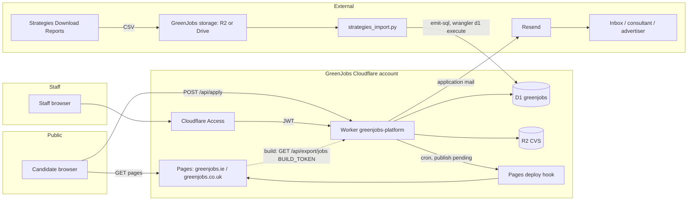

# GreenJobs platform: architecture

Written 2026-11-07. Internal engineering doc. Scope: the two boards greenjobs.ie (site `ie`) and
greenjobs.co.uk (site `uk`) moving off Strategies (classic ASP) before the contract ends on Sun 6 Dec 2026.
Target switch Thu 3 Dec, buffer Fri 4 Dec. Sources: `../FEASIBILITY_MATRIX.md` (§1, §3, §7, §8),
`../transition_plan.html`, `d1/schema.sql`, `d1/upserts.sql`, `deliverables/greenjobs_redesign_2026-09-22/HANDOFF.md`.

## 1. Scope on 3 Dec

- **Floor (never trimmed):** both boards on Keith's domains with current jobs; staff posting console
  (post, edit, close); applications to an inbox.
- **Trimmable, in this order:** alert emails (Resend), candidate record import, newsletter. A trimmed item
  moves to the phase-2 list. The export archive is kept either way.
- **Phase 2 (Dec to Jan):** candidate and employer log-ins (no online payment); Broadbean / Idibu /
  LogicMelon feeds and one CRM. See §7.

## 2. Components

All Cloudflare pieces live in **GreenJobs' own Cloudflare account**. We work in it as a member, we do not own it.

| Piece | Cloudflare product | Purpose | Owner account | Cost tier |
|---|---|---|---|---|
| Static boards | Pages (one project per board, or one project with two custom domains) | Job list, job pages, sectors, guides, sitemap, JobPosting schema. Built by `build_site.py`, deployed by `deploy_cloudflare.sh` (refuses without `.greenjobs-build-ok` and a passing `validate_site.py`) | GreenJobs | Free |
| `greenjobs-platform` | Worker | Public API, apply endpoint, staff console API, export for the rebuild, cron `scheduled` handler | GreenJobs | Free; Workers Paid only if volumes need it (answer to Q9) |
| `DB` | D1 database `greenjobs` | Jobs, employers, candidates, applications, alert subscriptions, audit log, import batches (`d1/schema.sql`) | GreenJobs | Free |
| `CVS` | R2 bucket | CV files from applications; keys generated by the Worker | GreenJobs | Free at expected volume (answer to Q9) |
| `RATE` | KV (optional) | Rate-limit counters if the rate-limiting binding is not used | GreenJobs | Free |
| `APPLY_LIMITER` | Rate-limiting binding (optional) | Per-IP limit on `POST /api/apply` | GreenJobs | Free |
| Staff auth | Cloudflare Access (Zero Trust) | Gate on `/admin/` and `/api/admin/*`; the Worker also verifies the Access JWT | GreenJobs | Free tier, up to 50 users |
| Deploy hook | Pages deploy hook (secret `DEPLOY_HOOK_URL`) | Triggers a static rebuild after console writes | GreenJobs | Free |
| DNS | Cloudflare DNS, or the current DNS host if nameservers cannot move (answer to Q2) | Web records for both boards; MX/SPF/DKIM/DMARC copied exactly | GreenJobs / current DNS holder | Free |
| Mail sending | Resend (`MAIL_PROVIDER=resend`), outside Cloudflare | Application emails to the inbox; alert emails if kept | GreenJobs' Resend account | Free tier at expected volume (answer to Q9) |
| Mailboxes | Current mail host (answer to Q3) | info@ inboxes. Not changed by this project | GreenJobs | Unchanged |
| Analytics | GA4 (G-ZQPJGM484J IE, G-ZFW03XQE2N UK), Search Console | Kept from the old boards | GreenJobs' Google account (answer to Q11) | Free |
| Strategies | Old ASP boards and "Download Reports" | Source of the CSV exports until DNS moves | Strategies, until Sun 6 Dec | Billed to contract end |

### Worker routes

| Route | Auth | Purpose |
|---|---|---|
| `GET /api/jobs` | public | Live jobs for the site resolved from the request host (`HOST_SITE_MAP`); paginated |
| `GET /api/jobs/:id` | public | One live job; closed or other-site ids return 404 |
| `GET /api/export/jobs?site=` | bearer `BUILD_TOKEN` | Full live job set for `build_site.py` |
| `POST /api/admin/jobs`, `PUT /api/admin/jobs/:id` | Access JWT + `STAFF_EMAILS` | Create / edit (edit uses the `version` optimistic lock, stale = 409) |
| `POST /api/admin/jobs/:id/close` | Access JWT + `STAFF_EMAILS` | Close; idempotent |
| `POST /api/apply` | public, rate limited | Application with optional CV |
| `GET /admin/` | Access JWT + `STAFF_EMAILS` | Staff console page |

### Configuration

- Bindings: `DB`, `CVS`, `RATE` (optional), `APPLY_LIMITER` (optional).
- Vars: `DRY_RUN="1"` by default. Live sending needs `DRY_RUN="0"` **and** `LIVE_CONFIRM="send-applications"`.
  `HOST_SITE_MAP`, `ACCESS_TEAM_DOMAIN`, `ACCESS_AUD`, `STAFF_EMAILS`, `APPLY_ROUTING` (`inbox|consultant|advertiser`),
  `APPLY_INBOX_IE`, `APPLY_INBOX_UK`, `MAIL_PROVIDER` (`resend|none`), `MAIL_FROM`, `RATE_APPLY_PER_10MIN`,
  `RATE_ADMIN_PER_MIN`, `MAX_CV_BYTES`, `ALERTS_ENABLED="0"`, `NEWSLETTER_ENABLED="0"`, `ALLOWED_ORIGINS`.
- Secrets (Worker secrets only, never in `wrangler.toml`, git, logs or `.env` in the cloud): `RESEND_API_KEY`,
  `BUILD_TOKEN`, `DEPLOY_HOOK_URL`.

## 3. Data flows

### 3.1 Job post to the static board

1. Staff open `/admin/`. Access authenticates them; the Worker verifies the JWT (`ACCESS_TEAM_DOMAIN`, `ACCESS_AUD`)
   and checks the email against `STAFF_EMAILS`.
2. `POST/PUT /api/admin/jobs` writes the row to D1 with a prepared statement (`d1/upserts.sql`). Console ids are
   `'{site}:gj:{uuid v4}'`. Every write adds an `audit_log` row keyed on the `Idempotency-Key` (replay adds nothing).
3. The write marks a publish as pending.
4. The cron `scheduled` handler runs every 5 minutes. If a publish is pending, it calls `DEPLOY_HOOK_URL` once
   (debounced: many edits in 5 minutes give one rebuild).
5. The Pages build runs `build_site.py`, which fetches `GET /api/export/jobs?site=ie|uk` with `BUILD_TOKEN`,
   renders, validates, and deploys. A failed build leaves the last good deploy live.

The static page can lag the database by up to one rebuild. This is safe because `POST /api/apply` re-checks
liveness in D1: a closed job never accepts an application, whatever the cached page shows.

### 3.2 Application to the inbox

1. Candidate submits the form on the static page to `POST /api/apply` (same host, or an origin in `ALLOWED_ORIGINS`).
2. Worker checks: rate limit (`APPLY_LIMITER` or `RATE`, `RATE_APPLY_PER_10MIN`), honeypot and form timestamp,
   job is live on this site, field lengths, CV type, size (`MAX_CV_BYTES`) and magic bytes.
3. CV goes to R2 under a key the Worker generates (never from user input).
4. Row goes to `applications` with `dedupe_key = sha256(site|job_id|applicant_email)`; a double submit is a no-op.
5. Routing picks the address from `APPLY_ROUTING`: `APPLY_INBOX_IE/UK`, the job's `apply_email` (consultant), or
   the advertiser's address.
6. Mail via `MAIL_PROVIDER`. With `DRY_RUN="1"` the row is stored as `delivery_status='dry_run'` and nothing is sent.
   Live: `sent` on success, `failed` on error or timeout (see §8).

### 3.3 CSV import (after the DPA is signed)

1. A named person on Keith's side runs Strategies "Download Reports" (recruiters, candidate registrations, profiles,
   jobs, applications; per site; in batches). CSVs stay in GreenJobs' own storage (their R2 bucket or Drive). Never
   in git, never in `.tmp/`.
2. `strategies_import.py --site ie|uk --report <type> --csv <file> --as-of <date> --retention-months 24`
   validates against `strategies_mapping.json`. Dry-run by default; it writes a report with counts and
   evidence per rejected row, never PII values.
3. `--emit-sql PATH` (PATH outside the repo) writes upserts. Imported ids are `'{site}:strat:{strategies_id}'`.
4. Operator applies: `npx wrangler@4 d1 execute greenjobs --file=PATH`.
5. `import_batches` holds the sha256 of each file. A re-run of the same file is skipped. Imports never overwrite
   console-owned rows and never reopen a job staff closed.

### 3.4 Alerts (trimmable)

Off by default (`ALERTS_ENABLED="0"`). If kept: sign-up writes `alert_subscriptions` with status `pending` and a
hashed confirm token (double opt-in); the cron handler builds digests from live jobs and sends through Resend
from a sender subdomain (for example `mail.greenjobs.ie`). An unsubscribe is never undone by a re-subscribe
upsert. If trimmed, the flag stays `0` and nothing else changes. Newsletter follows the same pattern behind
`NEWSLETTER_ENABLED="0"` and is the last item in the trim order.

## 4. Diagram



ASCII fallback:

```
 Candidate ──GET──> Pages (greenjobs.ie / .co.uk) <──deploy── Pages deploy hook
     │                    │  build: GET /api/export/jobs (BUILD_TOKEN)   ^
     │ POST /api/apply    v                                              │ cron, if publish pending
     └──────────────> Worker greenjobs-platform ─────────────────────────┘
 Staff ──> Access ──JWT──>  │   │   │
                            │   │   └──> Resend ──> inbox / consultant / advertiser
                            │   └──────> R2 (CVs)
                            └──────────> D1 greenjobs
                                          ^
 Strategies reports ─CSV─> GreenJobs storage ─> strategies_import.py ─SQL─> wrangler d1 execute
```

## 5. Trust boundaries

| Boundary | Untrusted side | Control |
|---|---|---|
| Internet to `POST /api/apply` | All fields, CV bytes, headers, origin | Rate limit, honeypot + timestamp, length and type checks, magic bytes, server-side liveness, prepared statements, CRLF stripped from anything placed in mail headers, `ALLOWED_ORIGINS` |
| Internet to `GET /api/jobs*` | Query params, ids | Site from host only, live jobs only, page size bounded |
| Staff to `/admin/`, `/api/admin/*` | Requests without Access, forged JWT | Access in front; Worker verifies JWT signature, `aud`, issuer, expiry and rejects `alg: none`; email must be in `STAFF_EMAILS`; CSRF check on writes |
| Pages build to `/api/export/jobs` | Anyone without the token | Bearer `BUILD_TOKEN` (Worker secret and Pages build secret) |
| Strategies CSV to D1 | Every cell (formula, script, prompt text, encodings) | Validator in dry-run, mapping file, bounded retention, report with evidence, SQL emitted outside the repo, applied by the operator |
| Job text to rendered HTML | Description and title written by staff or imported | Escaped on render; limited markdown only |
| Worker to Resend | Provider errors, timeouts | Timeout, `delivery_status='failed'`, ops alert |

## 6. Environments

| Env | Where | Data | Mail |
|---|---|---|---|
| Local | `wrangler dev` + `wrangler d1 execute greenjobs --local`; `bash run_tests.sh` | Fixtures only | `DRY_RUN="1"`, `MAIL_PROVIDER="none"` |
| Staging | `*.pages.dev` from day one; a subdomain such as `staging.greenjobs.ie` once DNS access exists (answer to Q2). Behind Access until sign-off | Refreshed scrape plus imported data after the DPA | `DRY_RUN="1"` except for named test sends to our own inbox |
| Production | greenjobs.ie, greenjobs.co.uk (apex and www) from Thu 3 Dec | Live | `DRY_RUN="0"` + `LIVE_CONFIRM="send-applications"`, set by the operator on switch day |

Staging sign-off by Keith: Fri 27 Nov. Anything not signed off moves to phase 2 (§7 of the matrix).

## 7. Phase 2 and where it plugs in

- **Feeds (Broadbean, Idibu, LogicMelon), one CRM:** new ingest endpoints on the same Worker (for example
  `POST /api/feeds/{feed}`; not built), each with its own secret per vendor. They upsert into `jobs` with
  `source='feed'` and id `'{site}:{feed}:{ref}'`, the shape already reserved in `d1/schema.sql`. Nothing else
  changes: the rebuild and apply paths read `jobs` whatever the source. Which feeds: answer to Q7.
- **Candidate log-ins:** `candidates` table already exists (source `phase2`). Passwords do not come across from
  Strategies, so candidates set a new one. Needs a lawful basis and notice for the reset email.
- **Employer log-ins:** no online payment, no packages. Posting by employers writes the same `jobs` rows.
- Until then: staff post through the console; candidates apply without an account.

## 8. Failure modes

Rule: fail loud on delivery, degrade quietly on helpers.

| Failure | Behaviour |
|---|---|
| Application mail fails (Resend 4xx/5xx, timeout) | Row kept with `delivery_status='failed'`, CV kept in R2, alert to ops the same day; candidate still sees a receipt because the application is stored. Resend from the stored row after the fix |
| Static rebuild fails | Last good Pages deploy stays live; pending flag stays set so the next cron retries; ops alert |
| Deploy hook missing or rejected | Same as above; the Worker API still serves current data |
| D1 unavailable | Apply returns 503 with a retry message; nothing is half-written |
| R2 put fails | Apply returns 503; no application row without its CV |
| Access misconfigured | Admin routes return 401/403; public site unaffected |
| Alerts or newsletter fail | Logged and skipped; no effect on boards or applications |
| Stale static page shows a closed job | Apply re-checks liveness and refuses; job drops off at the next rebuild |
| Import file replayed | `import_batches` skip; zero new rows |
