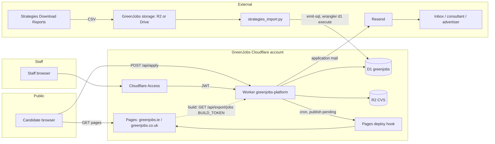

# GreenJobs platform: architecture

Written 2026-11-07. Internal engineering doc. Scope: the two boards greenjobs.ie (site `ie`) and
greenjobs.co.uk (site `uk`) moving off Strategies (classic ASP) before the contract ends on Sun 6 Dec 2026.
Target switch Thu 3 Dec, buffer Fri 4 Dec. Sources: `../FEASIBILITY_MATRIX.md` (§1, §3, §7, §8),
`../transition_plan.html`, `d1/schema.sql`, `d1/upserts.sql`, `deliverables/greenjobs_redesign_2026-09-22/HANDOFF.md`.

## 1. Scope on 3 Dec

- **Floor (never trimmed):** both boards on Keith's domains with current jobs; staff posting console
  (post, edit, close); applications to an inbox.
- **Trimmable, in this order:** alert emails (Resend), candidate record import, newsletter. A trimmed item
  moves to the phase-2 list. The export archive is kept either way.
- **Phase 2 (Dec to Jan):** candidate and employer log-ins (no online payment); Broadbean / Idibu /
  LogicMelon feeds and one CRM. See §7.

## 2. Components

All Cloudflare pieces live in **GreenJobs' own Cloudflare account**. We work in it as a member, we do not own it.

| Piece | Cloudflare product | Purpose | Owner account | Cost tier |
|---|---|---|---|---|
| Static boards | Pages (one project per board, or one project with two custom domains) | Job list, job pages, sectors, guides, sitemap, JobPosting schema. Built by `build_site.py`, deployed by `deploy_cloudflare.sh` (refuses without `.greenjobs-build-ok` and a passing `validate_site.py`) | GreenJobs | Free |
| `greenjobs-platform` | Worker | Public API, apply endpoint, staff console API, export for the rebuild, cron `scheduled` handler | GreenJobs | Free; Workers Paid only if volumes need it (answer to Q9) |
| `DB` | D1 database `greenjobs` | Jobs, employers, candidates, applications, alert subscriptions, audit log, import batches (`d1/schema.sql`) | GreenJobs | Free |
| `CVS` | R2 bucket | CV files from applications; keys generated by the Worker | GreenJobs | Free at expected volume (answer to Q9) |
| `RATE` | KV (optional) | Rate-limit counters if the rate-limiting binding is not used | GreenJobs | Free |
| `APPLY_LIMITER` | Rate-limiting binding (optional) | Per-IP limit on `POST /api/apply` | GreenJobs | Free |
| Staff auth | Cloudflare Access (Zero Trust) | Gate on `/admin/` and `/api/admin/*`; the Worker also verifies the Access JWT | GreenJobs | Free tier, up to 50 users |
| Deploy hook | Retired 2026-11-20: job pages are rendered by the Worker from D1 (§3.1); a static rebuild is needed only for template or guide changes | GreenJobs | Free |
| DNS | Cloudflare DNS, or the current DNS host if nameservers cannot move (answer to Q2) | Web records for both boards; MX/SPF/DKIM/DMARC copied exactly | GreenJobs / current DNS holder | Free |
| Mail sending | Resend (`MAIL_PROVIDER=resend`), outside Cloudflare | Application emails to the inbox; alert emails if kept | GreenJobs' Resend account | Free tier at expected volume (answer to Q9) |
| Mailboxes | Current mail host (answer to Q3) | info@ inboxes. Not changed by this project | GreenJobs | Unchanged |
| Analytics | GA4 (G-ZQPJGM484J IE, G-ZFW03XQE2N UK), Search Console | Kept from the old boards | GreenJobs' Google account (answer to Q11) | Free |
| Strategies | Old ASP boards and "Download Reports" | Source of the CSV exports until DNS moves | Strategies, until Sun 6 Dec | Billed to contract end |

### Worker routes

| Route | Auth | Purpose |
|---|---|---|
| `GET /api/jobs` | public | Live jobs for the site resolved from the request host (`HOST_SITE_MAP`); paginated |
| `GET /api/jobs/:id` | public | One live job; closed or other-site ids return 404. Carries `apply_mode` (`email`/`link`) and `apply_url` (link mode only); `apply_email` is never public |
| `GET /api/export/jobs?site=` | bearer `BUILD_TOKEN` | Full live job set for `build_site.py`, keyset paged: follow `next` until null. Same apply fields as above, never `apply_email` |
| `POST /api/admin/jobs`, `PUT /api/admin/jobs/:id` | Access JWT + `STAFF_EMAILS` | Create / edit (edit uses the `version` optimistic lock, stale = 409). Apply mode per job: `email` (optional `apply_email`, valid address) or `link` (`apply_url`, https only, no `javascript:`/`data:`); exactly one target per mode, else 400 naming the field |
| `POST /api/admin/jobs/:id/close` | Access JWT + `STAFF_EMAILS` | Close; idempotent |
| `POST /api/apply` | public, rate limited | Application with optional CV, email-mode jobs only; a link-mode job answers 409 `apply_externally` with its `apply_url` |
| `GET /admin/` | Access JWT + `STAFF_EMAILS` | Staff console page |
| `GET /{site}/jobs/`, `/{site}/jobs/<slug>/`, `/{site}/sectors/<slug>/`, `/sitemap-jobs.xml` | public, edge-cached 5 min | Board pages rendered from D1 (§3.1); closed/expired job 410, unknown 404; `/jobs/...` 301s here |
| `GET /api/stats?site=` | public, edge-cached 5 min | Every job-derived figure the static pages and the KPI dashboard print (`salary`, `sectors`, `regions`, `kpis`), same rules as `build_site.py`; `measures` (applications, alert sign-ups, advertiser enquiries) null until that feed exists |

### Configuration

- Bindings: `DB`, `CVS`, `RATE` (optional), `APPLY_LIMITER` (optional).
- Vars: `DRY_RUN="1"` by default. Live sending needs `DRY_RUN="0"` **and** `LIVE_CONFIRM="send-applications"`.
  `HOST_SITE_MAP`, `ACCESS_TEAM_DOMAIN`, `ACCESS_AUD`, `STAFF_EMAILS`, `APPLY_ROUTING` (`inbox|consultant|advertiser`:
  the default for an email-mode job with no `apply_email` of its own),
  `APPLY_INBOX_IE`, `APPLY_INBOX_UK`, `MAIL_PROVIDER` (`resend|none`), `MAIL_FROM`, `RATE_APPLY_PER_10MIN`,
  `RATE_ADMIN_PER_MIN`, `MAX_CV_BYTES`, `ALERTS_ENABLED="0"`, `NEWSLETTER_ENABLED="0"`, `ALLOWED_ORIGINS`.
- Secrets (Worker secrets only, never in `wrangler.toml`, git, logs or `.env` in the cloud): `RESEND_API_KEY`,
  `BUILD_TOKEN`, `DEPLOY_HOOK_URL`.
- Per-job apply mode (client answer Q8, 10-11 Nov: per client, an email or an ATS link) lives in `jobs.apply_mode`
  (`email` default | `link`), `jobs.apply_email`, `jobs.apply_url`; a schema CHECK allows exactly one target per mode.
  A D1 created before 2026-11-20 runs `d1/migrations/0001_apply_mode_consent_alerts.sql` once after `schema.sql`.

## 3. Data flows

### 3.1 Job post to the public board (Worker-rendered job pages, 2026-11-20)

Decision (panel B/D, 20 Nov): **job pages are server-rendered by the Worker from D1**; home, guides and the other
static pages stay the `build_site.py` build. There is no deploy hook, publish flag or `BUILD_TOKEN` rebuild in the loop.

1. Staff open `/admin/`. Access authenticates them; the Worker verifies the JWT (`ACCESS_TEAM_DOMAIN`, `ACCESS_AUD`)
   and checks the email against `STAFF_EMAILS`.
2. One form posts to IE, UK or both (`sites`). Sector (1-3), region (per site), job type and workplace are dropdowns
   from the frozen vocabulary `platform_worker/src/taxonomy.json` (see `platform_worker/TAXONOMY.md`). `POST /api/admin/jobs`
   writes, per site and in one batch, the `jobs` row, its `job_facets` row (migration 0002: canonical sectors, regions,
   type, workplace, contract tags, loc class, level, agency flag, salary label, taxonomy version) and an `audit_log` row
   keyed on the `Idempotency-Key`. Every field stays editable (`PUT`, `version` optimistic lock); Close asks for
   confirmation; a closed job reopens with `PUT {status: "live"}` (a passed closing date must be replaced).
3. The Worker renders, on each board's host, with the redesign's own `_shell`/`job`/`jobs` templates (frozen into
   `src/site_assets.gen.js` by `tools/export_site_assets.py`; `--check` runs in `run_tests.sh`):
   `/{site}/jobs/` (list; `?sector=`, `?loc=` (alias `?region=`), `?type=`, `?q=`, `?page=`; 25 server rows a page plus the
   `#gj-data` set `jobs.js` filters), `/{site}/jobs/<slug>/` (JobPosting JSON-LD, canonical URL; closed or expired = 410
   with a link to the list; unknown or draft = 404), `/{site}/sectors/<slug>/` (the list for one taxonomy sector),
   `/sitemap-jobs.xml`, and `GET /api/stats` (every job-derived figure the static pages print). `/jobs/...` and
   `/sectors/<slug>/` 301 to the `/{site}/` paths, which keep the static tree's relative links working.
   `<slug>` = the Strategies id for imported jobs (the URLs the demo already published), `gj-<uuid>` for console jobs.
4. Apply: link mode = external button `rel="noopener nofollow"`; email mode = the on-site form posting to
   `POST /api/apply` (DRY_RUN default unchanged). No page links to a Strategies URL.
5. Freshness: responses carry `s-maxage=300` and go through the Cache API, so a post is public within 5 minutes
   (metric M5: 15). `live.js` (home, insights, salary guide) and `dashboard.js` (KPI dashboard) replace the build-time
   figures with `/api/stats` on load; the static numbers remain the no-JS fallback.
6. The Worker never classifies. Import and feed rows get their `job_facets` from the Python classifier
   (`build_site.assign_sectors`, `resolve_regions`, `canon_type`, `contract_of`, `workplace_of`, `loc_class`,
   `level_of`, `is_agency`), which reads the same `taxonomy.json` (separate work unit). An imported job with no facet
   row still renders (no sector chip) until the classifier writes one.
7. Gates: `tests/greenjobs_redesign/platform/parity.test.mjs` (Worker vs `build_site.py` on the fixture: page
   structure, JSON-LD keys, `/api/stats` figures exactly) and `e2e_board.test.mjs` (console create -> page -> list,
   sector view, sitemap, stats -> edit -> close 410 -> reopen) run in `run_tests.sh`, which gates deploy.

Worker routes needed at go-live (wrangler.toml): `<host>/jobs*`, `<host>/ie/jobs*` (or `/uk/jobs*`),
`<host>/ie/sectors/*`, `<host>/sitemap-jobs.xml`, `<host>/api/*`, `<host>/admin*` on each board host. Vars:
`CANONICAL_ORIGIN_IE` / `CANONICAL_ORIGIN_UK` (e.g. `https://www.greenjobs.ie`; also used to 301 a request for the
other edition's path to its own domain) and `ROBOTS_INDEX="1"` once the boards are live (the demo shell is noindex).
`/api/export/jobs` stays for archive exports only.

`POST /api/apply` re-checks liveness in D1, so a cached page (at most 5 minutes old) can never take an application
for a closed job.

### 3.2 Application to the inbox

0. Link-mode jobs never reach this flow: the static page shows an external Apply button (`rel="noopener nofollow"`)
   to the job's https `apply_url`, and `POST /api/apply` answers 409 for them.
1. Candidate submits the on-site form (email-mode jobs) on the static page to `POST /api/apply` (same host, or an
   origin in `ALLOWED_ORIGINS`). `main.js` stamps the form's render time on page load.
2. Worker checks: rate limit (`APPLY_LIMITER` or `RATE`, `RATE_APPLY_PER_10MIN`), honeypot and form timestamp,
   job is live on this site, field lengths, CV type, size (`MAX_CV_BYTES`) and magic bytes.
3. CV goes to R2 under a key the Worker generates (never from user input).
4. Row goes to `applications` with `dedupe_key = sha256(site|job_id|applicant_email)`; a double submit is a no-op.
5. Routing: the job's own `apply_email` when set (per client, Q8); otherwise the `APPLY_ROUTING` default
   (`inbox` -> `APPLY_INBOX_IE/UK`; `consultant`/`advertiser` -> the site inbox plus a `route_fallback` audit row).
6. Mail via `MAIL_PROVIDER`. With `DRY_RUN="1"` the row is stored as `delivery_status='dry_run'` and nothing is sent.
   Live: `sent` on success, `failed` on error or timeout (see §8).

### 3.3 CSV import (after the DPA is signed)

1. A named person on Keith's side runs Strategies "Download Reports" (recruiters, candidate registrations, profiles,
   jobs, applications, Jobs By Email; per site; in batches). The real header rows (19 Nov) are in
   `import/REAL_HEADERS_2026-11-19.json`; `strategies_import.py --report <type> --sniff FILE` checks a file's
   headers (no values printed) before anything else. CSVs stay in GreenJobs' own storage (their R2 bucket or Drive). Never
   in git, never in `.tmp/`.
2. `strategies_import.py --site ie|uk --report <type> --csv <file> --as-of <date> --retention-months 24`
   validates against `strategies_mapping.json`. Dry-run by default; it writes a report with counts and
   evidence per rejected row, never PII values.
3. `--emit-sql PATH` (PATH outside the repo) writes upserts. Imported ids are `'{site}:strat:{strategies_id}'`.
4. Operator applies: `npx wrangler@4 d1 execute greenjobs --file=PATH`.
5. `import_batches` holds the sha256 of each file. A re-run of the same file is skipped. Imports never overwrite
   console-owned rows and never reopen a job staff closed.
6. Jobs set their apply mode from `AppLink` (https -> `link`) else `Email` (-> `email`) else the site default.
   Registration `Consent` and `Marketing` are carried to `candidates.strategies_consent` / `consent_marketing` and gate
   any later emailing. Jobs By Email rows become `alert_subscriptions` with status `pending` (re-confirmed before any
   send); a candidate with `Consent = 0` gets none. Mapping: `import/IMPORT_MAPPING.md`.

### 3.4 Alerts (trimmable)

Off by default (`ALERTS_ENABLED="0"`). If kept: sign-up writes `alert_subscriptions` with status `pending` and a
hashed confirm token (double opt-in); the cron handler builds digests from live jobs and sends through Resend
from a sender subdomain (for example `mail.greenjobs.ie`). An unsubscribe is never undone by a re-subscribe
upsert. If trimmed, the flag stays `0` and nothing else changes. Newsletter follows the same pattern behind
`NEWSLETTER_ENABLED="0"` and is the last item in the trim order.

## 4. Diagram



ASCII fallback:

```
 Candidate ──GET──> Pages (greenjobs.ie / .co.uk) <──deploy── Pages deploy hook
     │                    │  build: GET /api/export/jobs (BUILD_TOKEN)   ^
     │ POST /api/apply    v                                              │ cron, if publish pending
     └──────────────> Worker greenjobs-platform ─────────────────────────┘
 Staff ──> Access ──JWT──>  │   │   │
                            │   │   └──> Resend ──> inbox / consultant / advertiser
                            │   └──────> R2 (CVs)
                            └──────────> D1 greenjobs
                                          ^
 Strategies reports ─CSV─> GreenJobs storage ─> strategies_import.py ─SQL─> wrangler d1 execute
```

## 5. Trust boundaries

| Boundary | Untrusted side | Control |
|---|---|---|
| Internet to `POST /api/apply` | All fields, CV bytes, headers, origin | Rate limit, honeypot + timestamp, length and type checks, magic bytes, server-side liveness, prepared statements, CRLF stripped from anything placed in mail headers, `ALLOWED_ORIGINS` |
| Internet to `GET /api/jobs*` | Query params, ids | Site from host only, live jobs only, page size bounded |
| Staff to `/admin/`, `/api/admin/*` | Requests without Access, forged JWT | Access in front; Worker verifies JWT signature, `aud`, issuer, expiry and rejects `alg: none`; email must be in `STAFF_EMAILS`; CSRF check on writes |
| Pages build to `/api/export/jobs` | Anyone without the token | Bearer `BUILD_TOKEN` (Worker secret and Pages build secret) |
| Strategies CSV to D1 | Every cell (formula, script, prompt text, encodings) | Validator in dry-run, mapping file, bounded retention, report with evidence, SQL emitted outside the repo, applied by the operator |
| Job text to rendered HTML | Description and title written by staff or imported | Escaped on render; limited markdown only |
| Worker to Resend | Provider errors, timeouts | Timeout, `delivery_status='failed'`, ops alert |

## 6. Environments

| Env | Where | Data | Mail |
|---|---|---|---|
| Local | `wrangler dev` + `wrangler d1 execute greenjobs --local`; `bash run_tests.sh` | Fixtures only | `DRY_RUN="1"`, `MAIL_PROVIDER="none"` |
| Staging | `*.pages.dev` from day one; a subdomain such as `staging.greenjobs.ie` once DNS access exists (answer to Q2). Behind Access until sign-off | Refreshed scrape plus imported data after the DPA | `DRY_RUN="1"` except for named test sends to our own inbox |
| Production | greenjobs.ie, greenjobs.co.uk (apex and www) from Thu 3 Dec | Live | `DRY_RUN="0"` + `LIVE_CONFIRM="send-applications"`, set by the operator on switch day |

Staging sign-off by Keith: Fri 27 Nov. Anything not signed off moves to phase 2 (§7 of the matrix).

## 7. Phase 2 and where it plugs in

- **Feeds (Broadbean, Idibu, LogicMelon), one CRM:** new ingest endpoints on the same Worker (for example
  `POST /api/feeds/{feed}`; not built), each with its own secret per vendor. They upsert into `jobs` with
  `source='feed'` and id `'{site}:{feed}:{ref}'`, the shape already reserved in `d1/schema.sql`. Nothing else
  changes: the rebuild and apply paths read `jobs` whatever the source. Which feeds: answer to Q7. Client, 19 Nov:
  no live job comes through Broadbean or any other feed today (all posted by hand), so no feed is needed at go-live.
- **Candidate log-ins:** `candidates` table already exists (source `phase2`). Passwords do not come across from
  Strategies, so candidates set a new one. Needs a lawful basis and notice for the reset email.
- **Employer log-ins:** no online payment, no packages. Posting by employers writes the same `jobs` rows.
- Until then: staff post through the console; candidates apply without an account.

## 8. Failure modes

Rule: fail loud on delivery, degrade quietly on helpers.

| Failure | Behaviour |
|---|---|
| Application mail fails (Resend 4xx/5xx, timeout) | Row kept with `delivery_status='failed'`, CV kept in R2, alert to ops the same day; candidate still sees a receipt because the application is stored. Resend from the stored row after the fix |
| Static rebuild fails | Last good Pages deploy stays live; pending flag stays set so the next cron retries; ops alert |
| Deploy hook missing or rejected | Same as above; the Worker API still serves current data |
| D1 unavailable | Apply returns 503 with a retry message; nothing is half-written |
| R2 put fails | Apply returns 503; no application row without its CV |
| Access misconfigured | Admin routes return 401/403; public site unaffected |
| Alerts or newsletter fail | Logged and skipped; no effect on boards or applications |
| Stale static page shows a closed job | Apply re-checks liveness and refuses; job drops off at the next rebuild |
| Import file replayed | `import_batches` skip; zero new rows |
